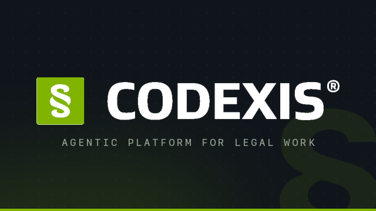
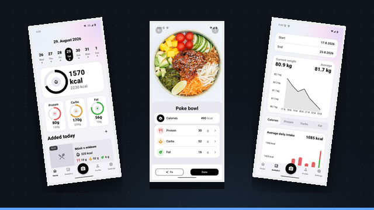
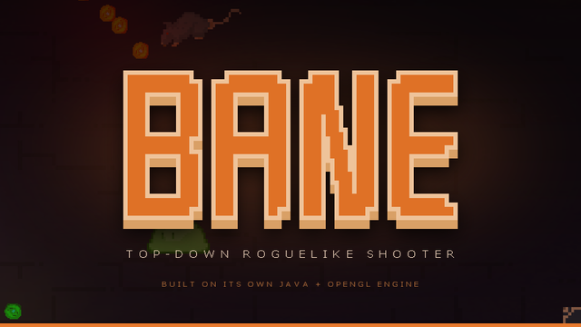

# Jiří Krokviak

**Software engineer** · Czech Republic

`Java` · `Python` · `Rust` · `Go` · `Kubernetes`

I work on **[Codexis](https://codexis.ai/)** — a native agentic AI platform for legal practice,
where connected legislation, case law and commentary get turned into something a lawyer can
actually work with. Most of my time goes into the agentic layer and the infrastructure that keeps
it fast, isolated and observable.

Outside of that I write games and mobile apps for the fun of the engineering underneath them.

## What I've built

<table>
  <tr>
    <td width="33.3%" align="center">
      
    </td>
    <td width="33.3%" align="center">
      
    </td>
    <td width="33.3%" align="center">
      
    </td>
  </tr>
  <tr valign="top">
    <td>
      <b><a href="https://codexis.ai/">Codexis AI</a></b> 
      Agentic AI platform for legal work — legislation, case law and commentary, connected. 
      <code>Java</code> <code>Python</code> <code>Rust</code> <code>Go</code> <code>Kubernetes</code>
    </td>
    <td>
      <b><a href="https://github.com/Empatixx/kalky">Kalky</a></b> 
      Food and nutrition tracking for Android and iOS. Log a meal by photographing it — a vision model does the rest. 
      <code>Kotlin Multiplatform</code> <code>Compose</code> <code>Bun</code> <code>OpenAI</code>
    </td>
    <td>
      <b><a href="https://github.com/Empatixx/Bane">Bane</a></b> 
      Top-down roguelike shooter on a game engine I wrote myself — renderer, audio, netcode, all of it. 
      <code>Java</code> <code>LWJGL</code> <code>OpenGL</code> <code>KryoNet</code>
    </td>
  </tr>
</table>

## Stack

**Languages**

**Services & APIs**

**Data & messaging**

**Machine learning**

**Infrastructure & ops**

## Education

**Masaryk University** — Master's, Computer Software Engineering · *2025 – 2027*
> Thesis (in progress): a legal-focused agentic cloud platform that gives every user an isolated
> environment.

**VŠB – Technical University of Ostrava** — Bachelor's, Computer Science · *2022 – 2025*
> Graded in the **top 3%**. Thesis: *Individual Professional Practice in the Company — scalable
> legal AI* — [dspace.vsb.cz](https://dspace.vsb.cz/handle/10084/157116)

## Competitions

**MČR 2022** — competed at the Czech national programming championship, among the country's top
student developers. Solutions: [Domino](https://github.com/Empatixx/MCR-Domino) ·
[Pac-Man](https://github.com/Empatixx/MCR-Pac-Man)

Czech Republic · always up for talking about agents, search, and things that run in microVMs.

